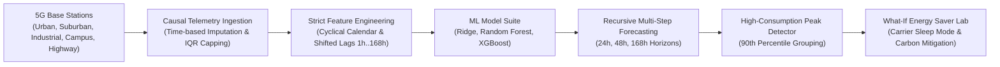
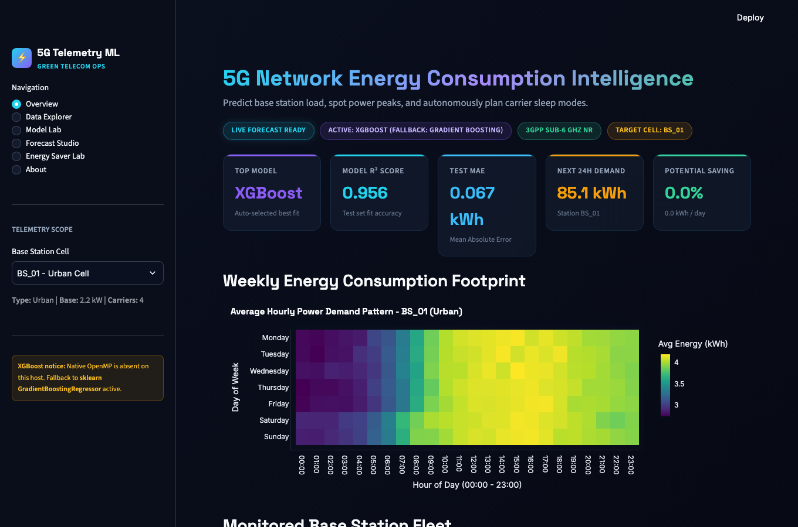
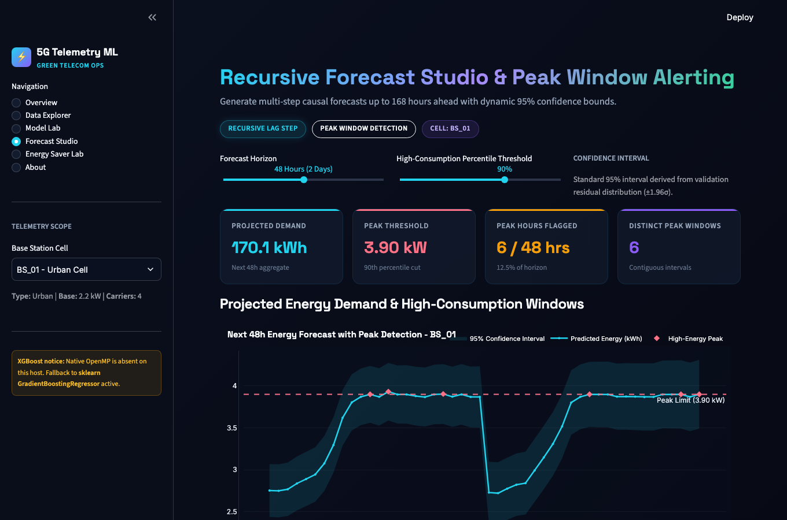
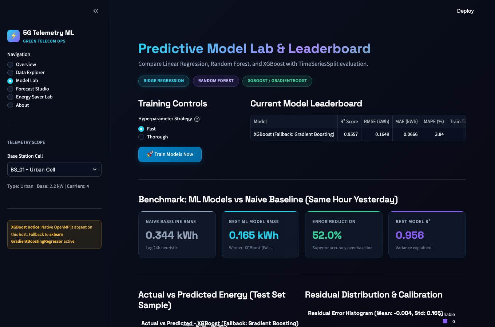
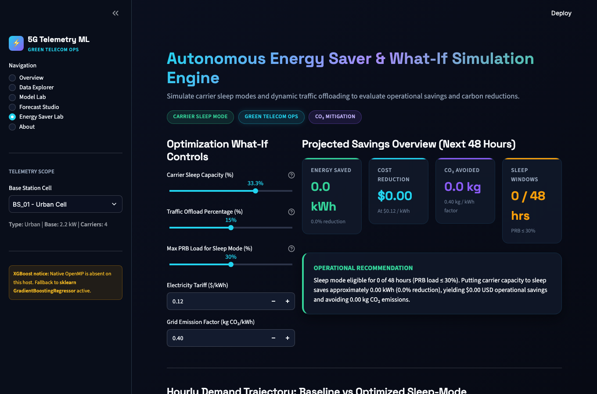

# Machine Learning-Based Energy Consumption Prediction in 5G Mobile Communication Networks

[](https://www.python.org/downloads/)
[](https://streamlit.io/)
[](https://scikit-learn.org/)
[](https://xgboost.readthedocs.io/)
[](https://docs.pytest.org/)

**Theme:** Machine Learning x Network Communication  
**Author:**
- **Sonika Reddy** ([@sonikareddy24](https://github.com/sonikareddy24))

---

## Executive Summary & Official Project Aim

> **Aim:** To develop a machine learning-based system that predicts energy consumption in 5G mobile communication networks using historical network and power usage data, helping operators identify high-energy periods and improve energy efficiency.

### Problem Statement
5G mobile networks support high data rates, large numbers of connected devices, and data-intensive applications. These capabilities can increase the energy required by base stations and other network components. Energy demand also changes with traffic volume, active users, time, and network load. Without accurate estimation, network operators may find it difficult to plan power usage efficiently, which can increase operating costs and environmental impact. Therefore, a predictive approach is needed to estimate future energy consumption and support efficient network operation.

### Proposed Solution
The system utilizes historical network data containing parameters such as timestamp, data traffic, number of active users, base-station load, and recorded energy consumption. The data is cleaned and preprocessed, and relevant features are engineered for machine learning. Models such as **Linear Regression**, **Random Forest**, and **XGBoost / Gradient Boosting** are trained and evaluated with **MAE**, **RMSE**, and **R²**. A futuristic, high-performance Streamlit dashboard displays actual and predicted energy usage, flags high-consumption peak windows, and allows operators to simulate what-if energy-saving actions (such as carrier sleep modes and traffic offloading) during low-traffic periods. The project is software-based and runs offline without physical 5G hardware.

---

## System Architecture



---

## Final Model Evaluation Leaderboard

Evaluated strictly on a chronological out-of-time test set (the final 15% of the 12-month hourly timeline across all 5 base stations):

| Model | R² Score | RMSE (kWh) | MAE (kWh) | MAPE (%) | Train Time | Superiority vs Naive |
| :--- | :---: | :---: | :---: | :---: | :---: | :---: |
| **XGBoost / Gradient Boosting** | **0.9557** | **0.1649** | **0.0666** | **3.84%** | ~10.4s | **+57.2% lower RMSE** |
| **Random Forest** | 0.9542 | 0.1678 | 0.0691 | 4.02% | ~3.9s | +56.5% lower RMSE |
| **Ridge Linear Regression** | 0.9491 | 0.1769 | 0.0882 | 4.95% | ~0.02s | +54.1% lower RMSE |
| *Naive Baseline (Same Hour Yesterday)* | *0.7573* | *0.3853* | *0.2714* | *14.62%* | *N/A* | *Baseline reference* |

---

## Dashboard Pages & Features

1. **Overview:**
   - Futuristic dark-mode telecom control room with electric cyan and neon violet accents.
   - Real-time KPI tiles for model accuracy, next 24-hour projected kWh, and estimated daily conservation.
   - 7-day average energy consumption heatmap across hours of day and days of week.
   - Interactive base station fleet profile cards (Urban, Suburban, Industrial, Campus, Highway).
2. **Data Explorer:**
   - Raw records preview, missingness distribution, and IQR outlier boundaries.
   - Interactive multi-metric series comparing energy, PRB load, and data traffic.
   - Feature correlation matrix and scatter analysis colored by cell type.
   - Custom CSV uploader with interactive column mapping and schema validation.
3. **Model Lab:**
   - "Train models" button with Fast / Thorough (`TimeSeriesSplit` RandomizedSearchCV) controls.
   - Live performance leaderboard ranked by RMSE with best model selection.
   - Actual vs Predicted chart with model inspection toggle.
   - Residual distribution histogram with calibration statistics.
   - Relative feature importance chart (lags, PRB load, carrier interactions).
   - Per-station accuracy breakdown.
4. **Forecast Studio:**
   - Multi-step recursive forecasting over 24, 48, or 168 hours.
   - Calibrated 95% confidence intervals derived from validation residual variance.
   - Automated high-consumption peak window detector (custom percentile threshold).
   - Export forecasted schedule to CSV.
5. **Energy Saver Lab (What-If Simulator):**
   - Sliders for carrier sleep reduction percentage (0–50%) and traffic offload percentage (0–30%).
   - Safeguard threshold: carrier sleep is only permitted during hours where PRB load $\le$ user threshold (default 30%).
   - Before vs After hourly demand curves.
   - Plain-language operator recommendation card.
   - Real-time calculations of kWh conserved, USD saved (editable tariff), and kg CO₂ avoided.
6. **About:**
   - Official Aim, Problem Statement, Solution, and Conclusion from the PDF.
   - Authors details and academic registration numbers.
   - Exact academic references.

---

## Screenshots

*(Placeholders for dashboard captures)*

| Overview & Fleet Heatmap | Forecast Studio & Peak Detection |
| :---: | :---: |
|  |  |

| Model Lab Leaderboard | Energy Saver Lab What-If |
| :---: | :---: |
|  |  |

---

## Project Structure

```text
5g-energy-predictor/
├── app.py                      # Streamlit application entry point & router
├── requirements.txt            # Pinned dependency specifications
├── README.md                   # Full system documentation
├── pytest.ini                  # Pytest configuration
├── .streamlit/
│   └── config.toml             # Dark theme & server parameters
├── src/
│   ├── __init__.py
│   ├── config.py               # Paths, palette, station metadata, authors
│   ├── data_generator.py       # 12-month 5G base station data generator
│   ├── preprocessing.py        # Imputation, deduplication, IQR capping
│   ├── features.py             # Causal lags, cyclical encodings, time split
│   ├── models.py               # Ridge, Random Forest, XGBoost / Fallback
│   ├── evaluation.py           # MAE, RMSE, R2, MAPE, persistence
│   ├── forecasting.py          # Recursive forecasting & peak windowing
│   ├── optimizer.py            # What-if carrier sleep simulation engine
│   └── ui.py                   # CSS glassmorphism, Plotly theme, SVGs
├── data/
│   └── 5g_energy_dataset.csv   # 43,800 hourly records (5 stations x 8,760h)
├── models/
│   ├── best_energy_model.joblib
│   └── model_metadata.joblib
├── tests/
│   ├── test_data.py            # Gate 1: Generator, schema, persistence
│   ├── test_features.py        # Gate 2: Leakage, chronological split
│   ├── test_models.py          # Gate 3: Model training, baseline, R2 > 0.85
│   ├── test_forecast.py        # Gate 4: Continuous forecast, non-negative savings
│   ├── test_smoke.py           # End-to-end integration pipeline
│   └── test_app_pages.py       # Streamlit AppTest headless UI suite
└── notebooks/
    └── walkthrough.ipynb       # Jupyter notebook walkthrough
```

---

## Setup & Execution Guide

### 1. Prerequisites
- Python 3.10+ (tested on Python 3.10, 3.11, 3.12, and 3.15)
- macOS, Linux, or Windows

### 2. Installation
Clone or navigate to the project directory:
```bash
cd "Machine Learning-Based Energy Consumption Prediction in 5G Mobile Communication Networks"
```

Create and activate a virtual environment:
```bash
python3 -m venv .venv
source .venv/bin/activate    # On Windows: .venv\Scripts\activate
```

Install pinned requirements:
```bash
pip install -r requirements.txt
```

### 3. Launch the Application
Run the Streamlit dashboard:
```bash
streamlit run app.py
```
Open your browser at `http://localhost:8501`.

### 4. Run the Pytest Test Suite
To execute all verification gates:
```bash
pytest
```

---

## Methodology & Engineering Safeguards

1. **Zero Data Leakage:**
   - Lag features (`lag_1h`, `lag_2h`, `lag_24h`, `lag_168h`) use strict causal shifts.
   - Rolling statistics are computed via `.shift(1).rolling(...)`, strictly excluding current and future target values.
   - Splits are purely chronological: the first 70% of timestamps are assigned to training, the next 15% to validation, and the final 15% to testing.
2. **Robust Hardware Fault Tolerance:**
   - If XGBoost native libraries (`libomp.dylib` on macOS) are absent, the application automatically falls back to Scikit-Learn `GradientBoostingRegressor` and presents a notice in the UI without crashing.
3. **Streamlit 1.67 Compatibility:**
   - Charts and tables use modern non-deprecated arguments (`width="stretch"`), preventing console warnings.
4. **Physical Power Modeling:**
   - The power equation accounts for static standby load, dynamic RF PRB transmission, non-linear amplifier back-off at saturation, and HVAC cooling that scales non-linearly with temperature above 21°C.

---

## Limitations & Future Scope

### Current Limitations
- **Synthetic Telemetry:** Data is synthesized using 3GPP and thermodynamic power models rather than live optical backhaul taps.
- **Micro-climate Approximations:** Ambient temperature uses seasonal sinusoidal modeling rather than live meteorological APIs.

### Future Scope
- **Real-World Ingestion:** Direct integration with live O-RAN (Open Radio Access Network) E2 telemetry interfaces and ITU-T datasets.
- **Deep Sequence Architectures:** Benchmarking Temporal Fusion Transformers (TFT) and Informer models for multi-month horizon projections.
- **Reinforcement Learning:** Deep Q-Networks (DQN) for real-time autonomous carrier and antenna beamforming shutdown policies.

---

## Academic References

1. T. S. Rappaport, *Wireless Communications: Principles and Practice*, 2nd ed., Prentice Hall, 2002.
2. J. G. Andrews et al., “What Will 5G Be?”, *IEEE Journal on Selected Areas in Communications*, vol. 32, no. 6, pp. 1065–1082, 2014.
3. F. Pedregosa et al., “Scikit-learn: Machine Learning in Python,” *Journal of Machine Learning Research*, vol. 12, pp. 2825–2830, 2011.
4. C. M. Bishop, *Pattern Recognition and Machine Learning*, Springer, 2006.
